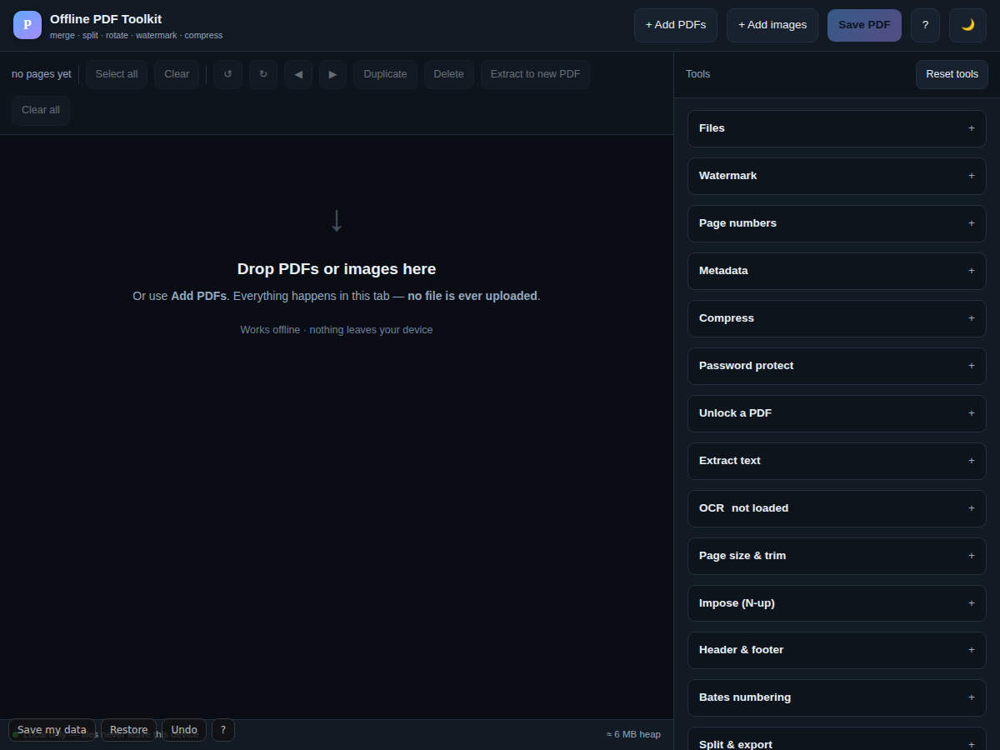
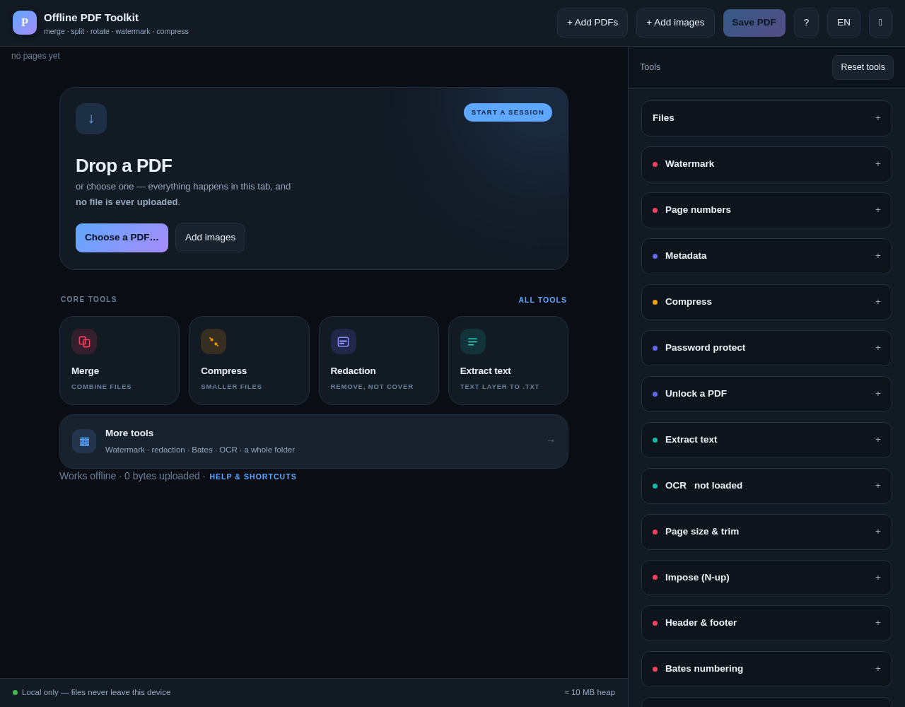
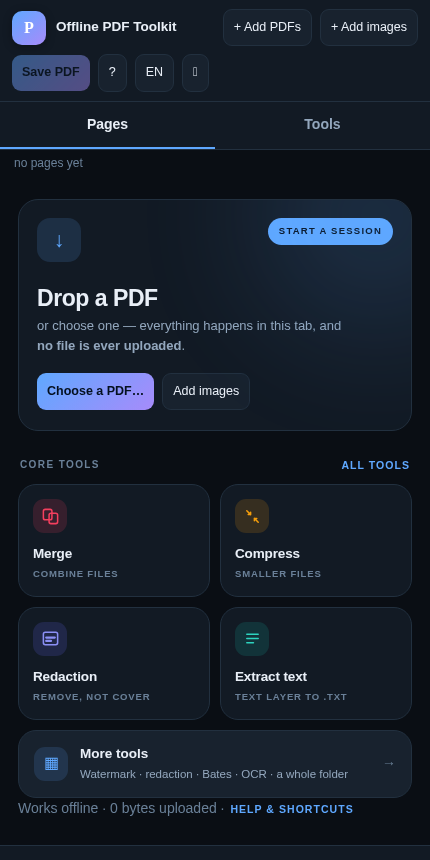
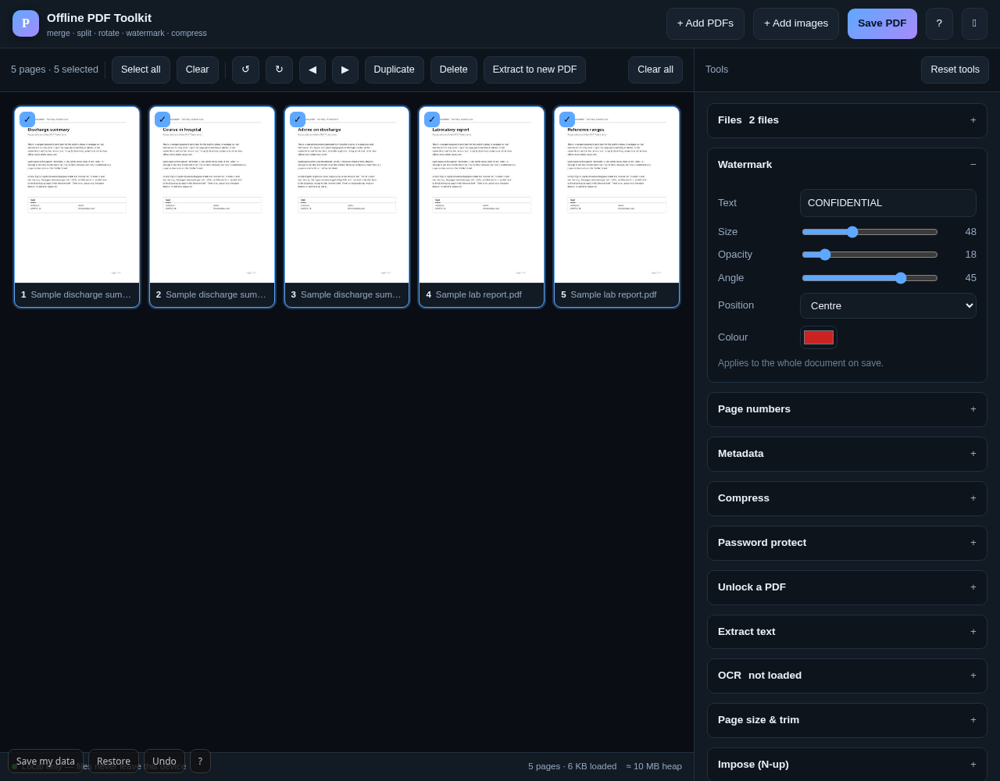

# Offline PDF Toolkit

      

**Merge, split, rotate, watermark, number, protect and compress PDFs — in one small page, with no
server to send them to.** The page itself is about **49 KB gzipped**; the PDF engines load only when
you open a document, and the OCR and qpdf engines only when you ask for them. No upload, no account,
no tracking, no install. Unplug the network and it still works.

**[Open the toolkit →](https://drsamonline.github.io/offline-pdf-toolkit/play/)** ·
[landing page](https://drsamonline.github.io/offline-pdf-toolkit/) ·
[downloads](#downloads) ·
[what's planned](ENHANCEMENTS.md)

<!-- shot:start -->



<!-- shot:end -->

## Why it exists

The files people merge and split are usually the ones they should not hand to a stranger's server —
patient reports, contracts, statements, identity documents. Every "free PDF tool" online uploads
your file. This one cannot: the PDF engine is compiled into a single HTML file and there is no
backend to send anything to. The proof is that it runs with the cable pulled out.

| | | |
|---|---|---|
|  |  |  |

The empty state is the front door: drop a file on the hero, or take one of the four tools a report
usually needs. Every tool in the app is in one catalogue — the launcher, the all-tools sheet and the
category dot beside each sidebar section all read from it.

## Features

| | |
|---|---|
| **Launcher** | The empty state offers a drop target, the last files this tab wrote, and four core tools in one tap. Choose a tool with nothing open and it asks for the file, then opens itself. |
| **All tools** | 27 tools in one sheet, grouped Edit / Optimize / Secure / Convert / Trust, with search. |
| **Session list** | Every file the app writes, with the tool that made it and its size — in `sessionStorage`, so it dies with the tab, and the bytes are never kept. |
| **Merge** | Add several PDFs; they lay out in order. Drag any page to reorder. |
| **Split / extract** | Select pages (shift-click for a range) and pull them into a new PDF. |
| **Rotate** | 90° steps, left or right, per page or for a whole selection. |
| **Reorder / duplicate / delete** | Drag and drop, or move selections earlier/later. |
| **Trim & resize** | Cut the same margin off every edge, or re-lay mixed pages onto A4 / Letter — text stays selectable. |
| **Impose** | 2-up, 4-up and saddle-stitch booklet on A4 landscape sheets. |
| **Watermark** | Text, centre / tiled / corner, with size, opacity, angle and colour. |
| **Header & footer** | Six positions, with `{n}`, `{total}`, `{date}` and `{file}` tokens. |
| **Bates numbering** | Prefix, start, zero-padded digits, four positions. |
| **Split** | Every N pages, one file per page, or ranges (`1-3, 4, 8-10`). |
| **Export images** | Every page as a PNG at the DPI you choose. |
| **Redaction** | Cover every match of a word — or of a shape: 12-digit numbers, phone numbers, emails, PAN, dates, IFSC, and labelled identifiers (MRN, UHID, OPD, policy). With *rebuild* on the page is rasterised, so the text underneath is really gone. |
| **Form fields** | Reads the AcroForm, fills it, and flattens the values into the page so they cannot be edited back. |
| **Signature** | Draw it with a mouse or finger, or load a picture; the empty margin is trimmed and it is stamped where you choose. |
| **Extract images** | Recovers the pictures stored inside the PDF at their original resolution. |
| **Compress, three ways** | *Photos only* re-encodes the JPEGs and leaves the text as text; *lossless* runs qpdf over the result; *every page* rasterises, with an optional greyscale pass. |
| **Batch** | *One file per source* — the same tools on every loaded document, one output each. |
| **Share locked** | Wrap the finished PDF in a single HTML file that asks for a PIN — AES-256-GCM, the same container [LockHTML](https://github.com/drsamonline/lockhtml) writes, so either viewer opens either file. |
| **Page labels** | The numbers a reader *sees*: i, ii, iii for the front matter and 1, 2, 3 for the body, written as a `/PageLabels` tree. |
| **Compare** | Reads the text of the first two documents and reports the pages that differ, with the first line that changed. |
| **A whole folder** | Pick a folder, and every PDF in it is processed and written to an `out` folder beside it. Chrome, Edge and Android Chrome only — the button says so when the browser cannot. |
| **Insert blank pages** | Drop an empty page after the selection, sized like the page before it. |
| **Interface languages** | English, हिन्दी and ગુજરાતી for the interface, switched in the header and remembered. |
| **Remembered tools** | Your tool settings come back on the next visit; *Reset tools* forgets them. |
| **Flatten & strip** | Flatten form fields, or remove the metadata before sending a file on. |
| **Page numbers** | Four formats, four positions, starting number, size. |
| **Metadata** | Title, author, subject, keywords. |
| **Compress** | Renders each page to JPEG at a chosen DPI and quality, then rebuilds. |
| **Images → PDF** | PNG and JPEG, one image per page. |
| **Open a protected PDF** | Asks for the password, then lets you edit it — and keeps the protection on the way out unless you set a new one. |
| **Password protect** | AES-256, with user/owner passwords and permissions for printing, copying, modifying. |
| **Unlock** | Remove a password you already know, in the browser. |
| **Extract text** | From a digital PDF → `.txt`. |
| **OCR** | From a scan. The engine ships beside the app, so it works offline on the first try. |
| **Credits** | All bundled libraries credited in-app and in `THIRD-PARTY-NOTICES.md`. |
| **Themes** | Dark, light, high-contrast. |
| **Network counter** | Every `fetch` and `XMLHttpRequest` this page makes, listed in the app. A fresh copy reads `0 requests`. |
| **Self-test** | Proves merging, rotating, cropping and AES-256 work — on your machine, in your tab. |
| **Command palette** | `Ctrl-K` — every tool by name. |
| **Undo / redo** | `Ctrl-Z` and `Shift-Ctrl-Z` across rotate, delete, duplicate, move and loading files. |
| **Keyboard** | `Alt-←` / `Alt-→` moves the selected pages; the grid is a labelled listbox for screen readers. |
| **Shortcuts** | `a` select all · `d` deselect · `[` `]` rotate · `Delete` remove · `t` theme · `Ctrl-K` commands · `Ctrl-Z` undo · `Alt-←/→` move pages · `?` help |

## Not included, deliberately

- **PDF/A conversion** and **Ghostscript-class compression.** These need AGPL-licensed components
  (Ghostscript, PyMuPDF, CoherentPDF). Using them would force this app to be AGPL, which is
  incompatible with the licence below. The one engine that is permissive enough — **qpdf**, which is
  Apache-2.0 — is included for the lossless pass.
- **Editing page content.** The toolkit rearranges and annotates pages; it does not edit text inside them.

## Downloads

The same HTML in a shell, built from the same commit as the page you are reading.

| | | |
|---|---|---|
|  **In the browser** | nothing to install | [open the app](https://drsamonline.github.io/offline-pdf-toolkit/play/) |
|  **Windows** | portable EXE, 9.0 MB, no installer | [offline-pdf-toolkit-portable.exe](https://github.com/drsamonline/offline-pdf-toolkit/releases/latest/download/offline-pdf-toolkit-portable.exe) |
|  **Android** | signed APK, 1.2 MB | [offline-pdf-toolkit.apk](https://github.com/drsamonline/offline-pdf-toolkit/releases/latest/download/offline-pdf-toolkit.apk) |
|  **Linux** | single binary, 21.4 MB | [offline-pdf-toolkit-linux](https://github.com/drsamonline/offline-pdf-toolkit/releases/latest/download/offline-pdf-toolkit-linux) |

Every release carries the app icon alongside the artefacts (`icon-192.png`, `icon-512.png`), so the
downloads identify themselves in a file manager instead of arriving as a grey box.

- **Rolling build** — <https://github.com/drsamonline/offline-pdf-toolkit/releases/tag/app-latest>,
  rebuilt from `main` on every push; the `releases/latest/download/...` links above always point here.
- **Versioned release** — <https://github.com/drsamonline/offline-pdf-toolkit/releases/tag/v1.3.0>
  records what changed and why, with the icons attached.

## Files

```
app.html                     the application shell (~156 KB; the engines live in lib/)
index.html                   landing page (root deployment)
docs/index.html              landing page (Pages deployment)
docs/play/index.html         the application, as Pages serves it
docs/assets/                 badges, screenshots, icons, sample PDFs (all local):
                               two text documents, a photograph page, and one written
                               uncompressed so the lossless pass has something to prove
docs/play/lib/               pdf.js, pdf-lib and the pdf.js worker, loaded on demand
docs/play/ocr/               the OCR engine: wrapper, worker, two LSTM WASM cores, English data
docs/play/qpdf/              the qpdf WASM runtime for the lossless compression pass
pipeline/app_template.html   the application source (readable)
pipeline/landing.html        the landing page source (readable)
pipeline/app_extras.js       the 1.3–1.6 tools (trim, impose, redaction, split, forms, signatures…)
pipeline/app_i18n.js         the हिन्दी and ગુજરાતી interface tables
pipeline/app_extras_ui.html  the panels for them
pipeline/app_launcher.js      the tool catalogue, the launcher and the all-tools sheet
pipeline/kit_extras.html     export / restore / undo / keyboard, kept in the source
pipeline/build_pdf.py        inlines the libraries + minifies → app.html
pipeline/build_landing.py    emits index.html + docs/index.html from landing.html
vendor/                      the three libraries, with SHA256SUMS checked at build time
tools/badges.py              draws docs/assets/badge-*.svg — no image service
tools/shot.py                takes the screenshots with headless Chromium (dev only)
tools/make_samples.py        generates the sample PDFs the demo and screenshots use
tools/test/                  the browser suites (124 checks) and run_all.py — run in CI on every push
tools/fetch_ocr.py           fetches the OCR engine once and verifies it against SHA256SUMS
tools/fetch_qpdf.py          the same for qpdf (Apache-2.0), the lossless compressor
sw.js                        offline cache (identical copy in docs/sw.js)
```

`build_pdf.py` reads the three libraries from `vendor/`, verifies each against
`vendor/SHA256SUMS`, writes them beside the app in `docs/play/lib/` and
minifies the app's own CSS/JS/HTML on the way out. The readable template stays in `pipeline/`.
`build_landing.py` emits both landing pages from the one source and stamps the build in the footer,
so "am I on the new one?" is answerable from the page itself.

The badges are generated, not fetched: an offline-first app should not need an image service to
describe itself. `python3 tools/badges.py` redraws them, and every claim in them is checked against
this repository.

## Licences

- **App code** © Dr Sohil Momin — free for personal study, teaching and non-commercial practice;
  commercial use requires a licence; educational institutes free or at a discounted rate.
- **pdf-lib** (Cantoo fork) — MIT · **pdf.js** — Apache-2.0 (Mozilla) ·
  **tesseract.js** and **Tesseract OCR** — Apache-2.0 · **qpdf** — Apache-2.0 ·
  **qpdf-run** — MIT. See [`THIRD-PARTY-NOTICES.md`](THIRD-PARTY-NOTICES.md).
- **No third-party data is bundled** — no corpora, no fonts, no text of its own.

Because the bundled libraries are permissive rather than copyleft, this app can carry normal
commercial licensing terms.

Two techniques here — re-encoding the JPEGs inside a PDF while leaving the text alone, and trimming
a signature to its ink before placing it — were inspired by [PaperKnife](https://github.com/potatameister/PaperKnife).
PaperKnife is AGPL-3.0, which this app cannot be, so **no code was taken**: the implementations here
were written against the pdf-lib and pdf.js APIs already in the file.

## How to check it, rather than believe it

- **Network panel** in the app: a live count and list of every request the page has made, split by
  whether it left this origin. Open a fresh copy, load a document, run OCR — it reads
  **`0 external`** throughout. The engine shows up as *this origin*, which is the point.
- **Self-test** in the app: builds three pages from nothing, rotates one, crops one, encrypts
  with AES-256, proves the file will not open without the password, and reads the text back
  through pdf.js. Every line reports pass or fail, in your tab, on your machine.
- **The build**: `vendor/SHA256SUMS` is checked before anything is inlined, so the shipped file
  is built from the exact library bytes on record.
- **A Content-Security-Policy** in the built page: `connect-src 'self' blob: data:` — no other
  origin is named anywhere, so the browser itself refuses any other destination. The promise is
  structural rather than a paragraph.

## Handing a document to someone else

A PDF with a password needs a viewer that asks for one, and most phones will just refuse to open it.
*Share locked* writes something simpler: one `.html` file that opens in any browser, asks for a PIN,
and then shows the PDF. AES-256-GCM with a PBKDF2-SHA256 key (250,000 rounds), a random 16-byte salt
and a 12-byte IV per file, and the plaintext never leaves the tab.

The container is the one [LockHTML](https://github.com/drsamonline/lockhtml) defines — same payload
shape, same key derivation — so a file locked here opens in that viewer and the reverse. Only the PIN
path is implemented here; LockHTML's shares, recipients and decoys are not.

Two honest limits: a one-time view is enforced by `localStorage`, so it is one-time *on that
browser*, not on the planet; and a six-character PIN is the floor, not a recommendation.

## Languages

The interface speaks English, Hindi and Gujarati — the language button in the header cycles them and
the choice is remembered. The Help text and the longer explanatory paragraphs stay in English on
purpose: a mistranslated word in a document tool that handles clinical paperwork is worse than an
English one, and those passages want a human read before they are translated.

The 100 short interface strings were translated by a model and then **read by a native speaker**
(Dr Sohil Momin, 2 November 2026) against a numbered review sheet — 100 pairs with the real screens
in both languages — who reported no corrections needed. That review is the reason the interface can
claim to be checked rather than merely translated.

Labels added after 1.6.0 (the folder panel, Share locked, page labels, Compare, the redaction
patterns) are **still English**: 47 of them, listed in the same review sheet. They need a second
pass. `pipeline/app_i18n.js` is one file of plain string pairs, so a correction is a one-line
change.

## Privacy

Your documents are read into the browser's memory, processed on your own CPU, and written back to
your disk. Nothing is uploaded, stored or logged, and closing the tab discards everything.

There is no exception any more. OCR used to fetch its recognition engine from a CDN; the engine now
ships beside the app in `docs/play/ocr/` (about 10 MB, fetched once by a human with
`tools/fetch_ocr.py` and committed), so **the page makes no request to any other origin at all** —
not for your document, not for the engine. The Content-Security-Policy says `connect-src 'self'`,
which means the browser refuses anything else even if a future change tried.

---

## Built with Forge

This repo is a **Forge** app and adopts the shared kits.

- **Shared build workflow** — `.github/workflows/build-apps.yml` calls the reusable
  build in [`drsamonline/app-builder`](https://github.com/drsamonline/app-builder).
  On every push to `main` it builds a portable Windows **EXE** and a signed
  Android **APK** and attaches them to the `app-latest` release, so these URLs
  always track the newest build:

  - `https://github.com/drsamonline/offline-pdf-toolkit/releases/latest/download/offline-pdf-toolkit-portable.exe`
  - `https://github.com/drsamonline/offline-pdf-toolkit/releases/latest/download/offline-pdf-toolkit.apk`


Built with [Forge](https://github.com/drsamonline/forge) by Dr Sohil Momin.
