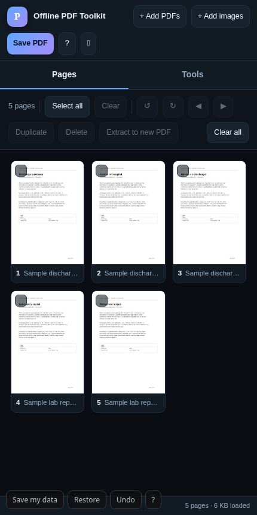

# Offline PDF Toolkit

     

**Merge, split, rotate, watermark, number, protect and compress PDFs — in one HTML file, with no
server to send them to.** No upload, no account, no tracking, no install. Unplug the network and it
still works.

**[Open the toolkit →](https://drsamonline.github.io/offline-pdf-toolkit/play/)** ·
[landing page](https://drsamonline.github.io/offline-pdf-toolkit/) ·
[downloads](#downloads) ·
[what's planned](ENHANCEMENTS.md)

<!-- shot:start -->


<!-- shot:end -->

## Why it exists

The files people merge and split are usually the ones they should not hand to a stranger's server —
patient reports, contracts, statements, identity documents. Every "free PDF tool" online uploads
your file. This one cannot: the PDF engine is compiled into a single HTML file and there is no
backend to send anything to. The proof is that it runs with the cable pulled out.

| | |
|---|---|
|  |  |

## Features

| | |
|---|---|
| **Merge** | Add several PDFs; they lay out in order. Drag any page to reorder. |
| **Split / extract** | Select pages (shift-click for a range) and pull them into a new PDF. |
| **Rotate** | 90° steps, left or right, per page or for a whole selection. |
| **Reorder / duplicate / delete** | Drag and drop, or move selections earlier/later. |
| **Trim & resize** | Cut the same margin off every edge, or re-lay mixed pages onto A4 / Letter — text stays selectable. |
| **Impose** | 2-up, 4-up and saddle-stitch booklet on A4 landscape sheets. |
| **Watermark** | Text, centre / tiled / corner, with size, opacity, angle and colour. |
| **Header & footer** | Six positions, with `{n}`, `{total}`, `{date}` and `{file}` tokens. |
| **Bates numbering** | Prefix, start, zero-padded digits, four positions. |
| **Split** | Every N pages, one file per page, or ranges (`1-3, 4, 8-10`). |
| **Export images** | Every page as a PNG at the DPI you choose. |
| **Redaction** | Cover every match of a word; with *rebuild* on, the page is rasterised so the text underneath is really gone. |
| **Flatten & strip** | Flatten form fields, or remove the metadata before sending a file on. |
| **Page numbers** | Four formats, four positions, starting number, size. |
| **Metadata** | Title, author, subject, keywords. |
| **Compress** | Renders each page to JPEG at a chosen DPI and quality, then rebuilds. |
| **Images → PDF** | PNG and JPEG, one image per page. |
| **Password protect** | AES-256, with user/owner passwords and permissions for printing, copying, modifying. |
| **Unlock** | Remove a password you already know, in the browser. |
| **Extract text** | From a digital PDF → `.txt`. |
| **OCR** | From a scan. Engine downloaded once (~7 MB) then cached; the document is never uploaded. |
| **Credits** | All bundled libraries credited in-app and in `THIRD-PARTY-NOTICES.md`. |
| **Themes** | Dark, light, high-contrast. |
| **Network counter** | Every `fetch` and `XMLHttpRequest` this page makes, listed in the app. A fresh copy reads `0 requests`. |
| **Self-test** | Proves merging, rotating, cropping and AES-256 work — on your machine, in your tab. |
| **Command palette** | `Ctrl-K` — every tool by name. |
| **Shortcuts** | `a` select all · `d` deselect · `[` `]` rotate · `Delete` remove · `t` theme · `Ctrl-K` commands · `?` help |

## Not included, deliberately

- **PDF/A conversion** and **Ghostscript-class compression.** These need AGPL-licensed components
  (Ghostscript, PyMuPDF, CoherentPDF). Using them would force this app to be AGPL, which is
  incompatible with the licence below. Compress here means rasterise-and-rebuild, which is
  permissive and works well on scans.
- **Editing page content.** The toolkit rearranges and annotates pages; it does not edit text inside them.

## Downloads

The same HTML in a shell, built from the same commit as the page you are reading.

| | | |
|---|---|---|
|  **In the browser** | nothing to install | [open the app](https://drsamonline.github.io/offline-pdf-toolkit/play/) |
|  **Windows** | portable EXE, 9.0 MB, no installer | [offline-pdf-toolkit-portable.exe](https://github.com/drsamonline/offline-pdf-toolkit/releases/latest/download/offline-pdf-toolkit-portable.exe) |
|  **Android** | signed APK, 1.2 MB | [offline-pdf-toolkit.apk](https://github.com/drsamonline/offline-pdf-toolkit/releases/latest/download/offline-pdf-toolkit.apk) |
|  **Linux** | single binary, 21.4 MB | [offline-pdf-toolkit-linux](https://github.com/drsamonline/offline-pdf-toolkit/releases/latest/download/offline-pdf-toolkit-linux) |

Every release carries the app icon alongside the artefacts (`icon-192.png`, `icon-512.png`), so the
downloads identify themselves in a file manager instead of arriving as a grey box. Releases:
<https://github.com/drsamonline/offline-pdf-toolkit/releases>

## Files

```
app.html                     the whole application (one self-contained file, ~2.0 MB)
index.html                   landing page (root deployment)
docs/index.html              landing page (Pages deployment)
docs/play/index.html         the application, as Pages serves it
docs/assets/                 badges, screenshots, icons, sample PDFs (all local)
pipeline/app_template.html   the application source (readable)
pipeline/landing.html        the landing page source (readable)
pipeline/app_extras.js       the 1.3 tools (trim, impose, redaction, split, self-test…)
pipeline/app_extras_ui.html  the panels for them
pipeline/kit_extras.html     export / restore / undo / keyboard, kept in the source
pipeline/build_pdf.py        inlines the libraries + minifies → app.html
pipeline/build_landing.py    emits index.html + docs/index.html from landing.html
vendor/                      the three libraries, with SHA256SUMS checked at build time
tools/badges.py              draws docs/assets/badge-*.svg — no image service
tools/shot.py                takes the screenshots with headless Chromium (dev only)
tools/make_samples.py        generates the sample PDFs the demo and screenshots use
sw.js                        offline cache (identical copy in docs/sw.js)
```

`build_pdf.py` reads the three libraries from `vendor/`, verifies each against
`vendor/SHA256SUMS`, embeds them directly into the HTML and
minifies the app's own CSS/JS/HTML on the way out. The readable template stays in `pipeline/`.
`build_landing.py` emits both landing pages from the one source and stamps the build in the footer,
so "am I on the new one?" is answerable from the page itself.

The badges are generated, not fetched: an offline-first app should not need an image service to
describe itself. `python3 tools/badges.py` redraws them, and every claim in them is checked against
this repository.

## Licences

- **App code** © Dr Sohil Momin — free for personal study, teaching and non-commercial practice;
  commercial use requires a licence; educational institutes free or at a discounted rate.
- **pdf-lib** (Cantoo fork) — MIT · **pdf.js** — Apache-2.0 (Mozilla) ·
  **tesseract.js** and **Tesseract OCR** — Apache-2.0. See [`THIRD-PARTY-NOTICES.md`](THIRD-PARTY-NOTICES.md).
- **No third-party data is bundled** — no corpora, no fonts, no text of its own.

Because the bundled libraries are permissive rather than copyleft, this app can carry normal
commercial licensing terms.

## How to check it, rather than believe it

- **Network panel** in the app: a live count and list of every request the page has made.
  Open a fresh copy and it reads `0 requests`. Load a document and it still reads `0`.
- **Self-test** in the app: builds three pages from nothing, rotates one, crops one, encrypts
  with AES-256, proves the file will not open without the password, and reads the text back
  through pdf.js. Every line reports pass or fail, in your tab, on your machine.
- **The build**: `vendor/SHA256SUMS` is checked before anything is inlined, so the shipped file
  is built from the exact library bytes on record.

## Privacy

Your documents are read into the browser's memory, processed on your own CPU, and written back to
your disk. Nothing is uploaded, stored or logged, and closing the tab discards everything.

The one exception is OCR: clicking *Load engine* downloads the recognition engine (~7 MB) from a
public CDN and caches it. That is the only network request the app ever makes, and it carries no
part of your document. Removing even that is the first item in [`ENHANCEMENTS.md`](ENHANCEMENTS.md).

---

## Built with Forge

This repo is a **Forge** app and adopts the shared kits.

- **Shared build workflow** — `.github/workflows/build-apps.yml` calls the reusable
  build in [`drsamonline/app-builder`](https://github.com/drsamonline/app-builder).
  On every push to `main` it builds a portable Windows **EXE** and a signed
  Android **APK** and attaches them to the `app-latest` release, so these URLs
  always track the newest build:

  - `https://github.com/drsamonline/offline-pdf-toolkit/releases/latest/download/offline-pdf-toolkit-portable.exe`
  - `https://github.com/drsamonline/offline-pdf-toolkit/releases/latest/download/offline-pdf-toolkit.apk`


Built with [Forge](https://github.com/drsamonline/forge) by Dr Sohil Momin.
